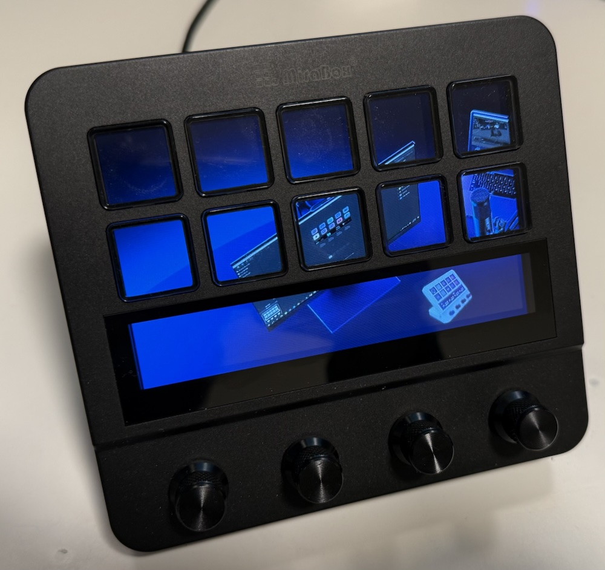
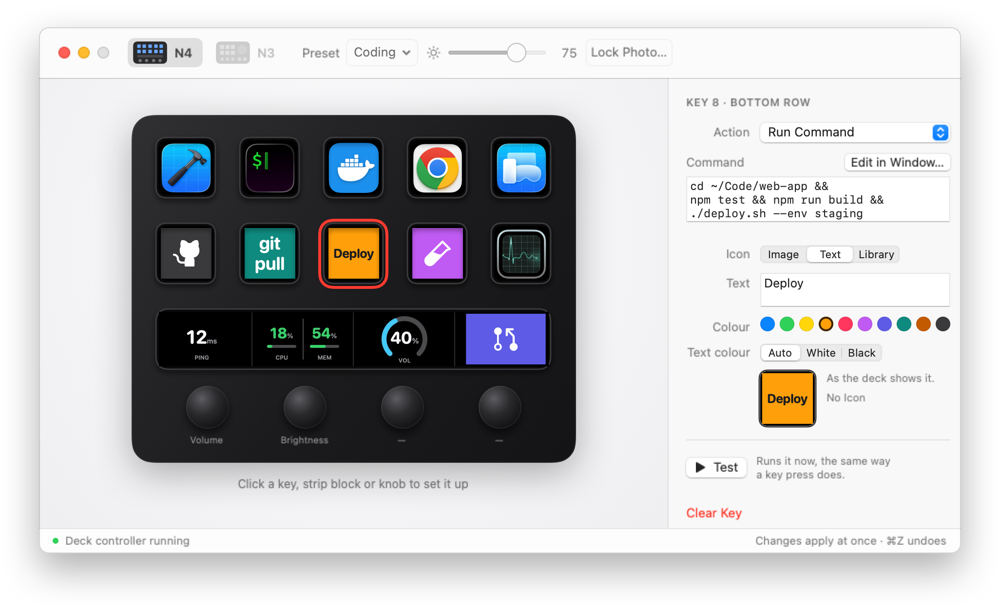

# DeckOut

<p align="center">
  
  &nbsp;&nbsp;
  
</p>

DeckOut is a Mac app for USB stream decks: the **TreasLin N3** (and its clones) and the **MiraBox Stream Dock N4**,
both at once if you like. You set up the keys, knobs and the N4's touch strip in a window, on a picture of your deck;
a small background part, DeckOut's deck controller, runs the decks from login, with no Dock or menu-bar icon once the
window is closed. It reconnects when a deck is unplugged and plugged back in, and picks up every change the moment
you make it.

<p align="center">
  <picture>
    <source media="(prefers-color-scheme: dark)" srcset="docs/assets/deckout-window-dark.png">
    
  </picture>
</p>

A key, button, knob or strip block can:
- **run your own commands and scripts**: anything you'd type in Terminal, or a script file, with your shell's
  environment; or one of Apple's Shortcuts;
- open an app, a web address, a file or a folder;
- send a keyboard shortcut, or play / pause, next and previous;
- turn the system volume or mute it; turn an external monitor's brightness over DDC/CI;
- on the N4, step through your presets with a swipe.

Keys show a picture, an app's icon, a symbol from the built-in library (Phosphor, 1,530 symbols) or a line of text.
The N4's strip blocks can be live: internet latency (red when there's no reply), CPU and memory load, and the volume.
While the Mac is locked the N4 can show a photo across its keys and strip.

Technically, the controller uses IOKit's `IOHIDManager` to claim each deck's vendor interface by USB vendor and product
ID (`0x5548:0x1001`, `0x6602:0x1001`), parses the decks' "CRT" packet protocol and maps every press, turn and tap to
its action. Keyboard shortcuts and media keys go through `CGEvent`, volume through CoreAudio, monitor brightness
through a bundled, patched [`m1ddc`](https://github.com/waydabber/m1ddc). Icons are drawn, JPEG-compressed and pushed
to the deck in chunks. The app and the controller talk over XPC, each checking the other's code signature.

### Why this exists

The manufacturer's software ("VSD Craft") is a ~980 MB Qt app bundled with 3,800+ files, a virtual keyboard plugin and
its own HTTP stack, all for what amounts to "press button, do thing". DeckOut is a native app of about 7 MB with no
dependencies beyond macOS, and its settings are one JSON file you can also edit by hand.

## Hardware

**TreasLin N3:** a USB stream deck with 6 LCD keys (72 × 72 pixels), 3 buttons, 1 large and 2 small knobs. Every
knob is also a push-button.

**Known clones / rebrands** that share the same USB VID/PID (`0x5548:0x1001`) and CRT protocol should work out of the
box:

- TreasLin N3 Pro
- Mirabox HSV602
- AJAZZ AKP03
- DOPWii / KKM-K3 (6-key + 3-knob variant)

If your device enumerates with VID `0x5548` / PID `0x1001` and speaks the CRT packet protocol, it will almost
certainly work.

**MiraBox Stream Dock N4** (`0x6602:0x1001`): 10 LCD keys in two rows of five, a touch strip of four image blocks
(tap each, or swipe across), and four push-knobs. Connect the N4 to a USB-A port: on a USB-C port it may not power up
after a replug (`docs/KNOWN_ISSUES.md`, KI-009).

Both decks can be plugged in at once, each with its own layout and presets.

**Other makers.** VSDinside (whose VSD Craft software these decks come with), MiraBox, SOOMFON and AJAZZ sell decks
that look and work much alike; some are the same hardware under another name. They differ in the details that
matter here, though: USB IDs, key counts, screen sizes and the codes each button sends. DeckOut recognises a deck by
its USB IDs and knows two layouts, so a model not listed above isn't supported yet, even if it looks the same. To
check yours: System Information → USB → the deck's Vendor ID and Product ID. `0x5548` / `0x1001` or `0x6602` /
`0x1001` should work; for anything else, open an issue with the IDs and a photo.

While the Mac is locked, keys, strip taps and swipes do nothing, and knobs keep only their volume, ZR7 and monitor
brightness actions.

### Protocol notes

The device uses 1025-byte HID reports (1-byte report ID + 1024-byte payload). Outbound commands are prefixed with
`CRT\0\0`. Inbound events are prefixed with `ACK`. A `CONNECT` keepalive must be sent every 5 seconds or the device
goes dark. LCD images are transferred via a `BAT` header (image length + key index) followed by raw JPEG data chunks.

## Requirements

macOS 15 (Sequoia) or later, on an Apple Silicon Mac. Tested on macOS 15.

## Install

1. Download `DeckOut-2.0.0.dmg` from [Releases](https://github.com/okoker/DeckOut/releases/latest).
2. Open it and drag DeckOut onto Applications. DeckOut runs only from Applications: opened anywhere else, it asks to
   be moved there.
3. Open DeckOut. macOS asks whether to open an app downloaded from the internet: Open. Then macOS shows "Background
   Items Added": that is DeckOut's deck controller, which runs your decks from login, also with the window closed.
4. Plug in a deck and start setting it up.

If you switch DeckOut off in System Settings → General → Login Items, the decks stop, and DeckOut says so when you
open it.

## Permissions

- **Accessibility**, for keyboard shortcuts, media keys and commands that send keystrokes: DeckOut → Settings (⌘,) →
  General → Allow… opens the list; switch DeckOut on. Nothing else needs it. Not Input Monitoring: version 1.0's
  instructions were wrong there.
- **Controlling other apps:** the first time a command of yours drives an app (`osascript`, for example), macOS asks
  once for that app, naming DeckOut.
- Monitor brightness needs no permission. Settings → Monitors lists the monitors DeckOut can reach; switch on the ones
  the brightness knob should turn.

## Coming from 1.0 (StreamDeckController, installed by hand)

- Opening DeckOut finds the old controller and asks first: **Retire It** stops it and moves its launch file aside, to
  `~/Library/LaunchAgents/com.streamdeck.controller.plist.retired-by-deckout`; its program and your config stay. With
  **Not Now** both run, and every press fires twice.
- Your `~/.config/vsd/config.json` carries over. DeckOut's first save keeps the file as it was in
  `config.json.before-app`, because 1.0 can't read the newer format.
- To go back: DeckOut → Settings → General → Stop and Remove…; put `config.json.before-app` back as `config.json`;
  rename the launch file back to `com.streamdeck.controller.plist` and run
  `launchctl bootstrap gui/$(id -u) ~/Library/LaunchAgents/com.streamdeck.controller.plist`.
- The old Input Monitoring entry for StreamDeckController can go.

## Updating

Quit DeckOut, download the new disk image, drag DeckOut onto Applications and choose Replace, then open DeckOut once:
it restarts the deck controller on the new version. Your settings stay.

## Removing

DeckOut → Settings → General → Stop and Remove…, then drag DeckOut to the Bin. Your settings stay in `~/.config/vsd`;
delete that folder too to remove everything, and DeckOut's entry under Privacy & Security → Accessibility.

The controller's log is `~/Library/Logs/DeckOut/agent.log`.

## Scripts and hand edits

DeckOut keeps everything in `~/.config/vsd/config.json`. You can edit it by hand: the file must be yours, not writable
by anyone else and not a symlink, or the controller refuses it and logs why. After an edit, tell the controller to read
it again:

```bash
/Applications/DeckOut.app/Contents/MacOS/DeckOutAgent --post-reload
```

The window reads the file again before its own saves, so it never writes over your edit.

### Action types

| Action | Format | Example |
|--------|--------|---------|
| Open an app | `app:<path>` | `app:/Applications/Notes.app` |
| Open a web address | `url:<address>` | `url:https://example.com` |
| Open a file or folder | `open:<path>` | `open:/Users/you/Downloads` |
| Run a Shortcut | `shortcut:<name>` | `shortcut:Start Timer` |
| Run a command | `shell:<command>` | `shell:open -a 'Slack'` |
| Run a program or script | `script:<path>` | `script:/Users/you/bin/backup.sh` |
| Keyboard shortcut | `key:<combo>` | `key:cmd+shift+s` |
| Media keys | `media_play_pause`, `media_next`, `media_previous` | — |
| System volume | `system_volume` | needs `step` |
| System mute | `system_mute_toggle` | — |
| ZR7 volume / mute | `zr7_volume`, `zr7_mute_toggle` | post `com.zr7.volumeUp` / `volumeDown` / `muteToggle` notifications, for an app that listens |
| Monitor brightness | `display_brightness` | needs `step` and `displays` |
| Cycle the brightness target | `display_brightness_cycle` | All → each monitor → All |
| Next preset | `next_preset` | the N4's swipe, or a knob press |
| Do nothing | `none` | — |

Commands, scripts and Shortcuts run with your login shell's environment (so Homebrew's tools are found), and are
stopped after 30 seconds. `shell:` commands run under `/bin/zsh -c`. Keyboard shortcuts take the modifiers `cmd`,
`shift`, `ctrl`, `alt` / `opt` and the keys `a`–`z`, `0`–`9`, `f1`–`f12`, `left`, `right`, `up`, `down`, `space`,
`return`, `tab`, `escape`, `delete`.

### Config reference

Shared settings at the top, one section per deck under `decks`. Each deck holds its presets and names the live one
(full example: `config.example.json`):

```jsonc
{
  "displays": [                    // monitors for the brightness knob (Settings → Monitors fills this in)
    { "name": "Left", "serial": "AN_SERIAL_FROM_M1DDC" }
  ],
  "decks": {
    "n3": {
      "brightness": 50,            // LCD key backlight (0–100)
      "knobs": {
        "big": {
          "rotate": { "action": "system_volume", "step": 5 },
          "press":  { "action": "system_mute_toggle" }
        }
      },
      "presets": [
        {
          "name": "Default",
          "buttons": {
            "lcd_1": { "action": "app:/Applications/Safari.app", "icon": "/Applications/Safari.app/Contents/Resources/AppIcon.icns" },
            "btn_1": { "action": "key:cmd+shift+a" }
          }
        }
      ],
      "active_preset": "Default"
    }
  }
}
```

- **N3:** knobs `big`, `small_1`, `small_2`, each with `rotate` and `press`; in each preset, `buttons` `lcd_1`–`lcd_6`
  and `btn_1`–`btn_3`, each with an `action` and an optional `icon`.
- **N4** (`decks.n4`): `brightness`; knobs `knob_1`–`knob_4` with `rotate` and `press`; `swipe` with one `action`;
  `lock_photo`; in each preset, `keys` `key_1`–`key_5` (top row) and `key_6`–`key_10` (bottom row), and `strip` blocks
  `"1"`–`"4"`, each with a `type` (`internet`, `load`, `volume`, `picture` with an `icon`, or `empty`) and an optional
  tap `action`.
- A deck section without `presets` reads as one preset, "Default". A config from 1.0 (`brightness`, `buttons` and
  `knobs` at the top level, no `decks`) still loads, as the N3 section; DeckOut saves it in the form above.

## Building from source

Needs the Xcode Command Line Tools (`xcode-select --install`), with Swift 6.

```bash
git clone https://github.com/okoker/DeckOut.git
cd DeckOut
make test                    # swift test
make app VARIANT=release     # build/DeckOut.app, signed ad hoc; move it to /Applications to run it
make app                     # build/DeckOut Dev.app: the development version, with its own settings in ~/.config/vsd-dev
```

To sign and notarise with your own Developer ID: copy `signing.mk.example` to `signing.mk` and fill it in, then
`make signed VARIANT=release` and `make notarize`.

## History

Version 1.0 was StreamDeckController, a background program you installed by hand, first called "VSD Display Controller"
after the manufacturer's software ("VSD Craft"). Version 2.0 is DeckOut, the app. The settings folder is still
`~/.config/vsd/`, so a 1.0 setup carries over.

## License

DeckOut is MIT licensed (© 2026 Koker): free to use, modify and distribute with attribution. See [LICENSE](LICENSE)
for the full text. It bundles two MIT-licensed projects:

- [Phosphor Icons](https://phosphoricons.com) 2.1.2 (© 2020–2021 Phosphor Icons): the symbol library for keys and
  strip blocks. Licence: `Packaging/Resources/Phosphor-LICENSE.txt`.
- [m1ddc](https://github.com/waydabber/m1ddc) (© 2021 waydabber), with a small patch (`Vendor/m1ddc/README.md`):
  monitor brightness over DDC/CI. Licence: `Vendor/m1ddc/LICENSE`.

Both licences are also in the app, under Settings → About. App icons shown on the decks belong to their makers.

## If you build something with this

Not required by MIT, but I'd appreciate hearing about it. Open an [Issue](https://github.com/okoker/DeckOut/issues/new)
tagged `show-and-tell`, leave a [star](https://github.com/okoker/DeckOut), or email <gitkoker@pm.me>.
