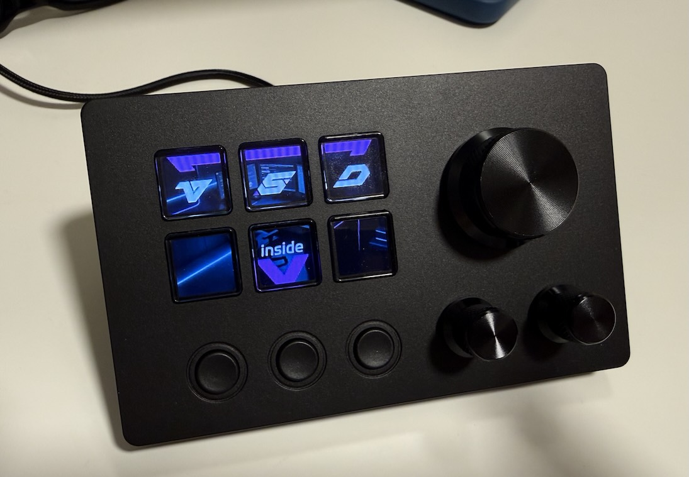

# DeckOut

| TreasLin N3 | MiraBox Stream Dock N4 |
|:---:|:---:|
|  |  |

**DeckOut runs USB stream decks from your Mac: the TreasLin N3, the MiraBox Stream Dock N4, and the same decks sold
under different names and brands.**

It comes in two parts. A small background daemon drives the decks: macOS starts it at login, and it keeps running
when the window is closed, with no Dock or menu-bar icon. A native Mac app is where you set them up: click a key,
knob or strip block on a picture of your deck and pick what it does. Changes reach the deck the moment you make them.

**Why bother?** These decks come with their makers' apps, and they are big: the smallest Mac download is 630 MB, for
what amounts to "press button, do thing". I didn't want that much bloat on my Mac, and the one I ran used more CPU
than I'd accept from something that runs all day. DeckOut is 7 MB installed. [More below](#why-deckout).

<p align="center">
  <picture>
    <source media="(prefers-color-scheme: dark)" srcset="docs/assets/deckout-window-dark.png">
    
  </picture>
</p>

## What a key can do

A key, an N3 button, a knob press or an N4 strip block can (the names are the app's):

- **Run Command** or **Run Script**: anything you'd type in Terminal, or a script file. They run with your login
  shell's environment, so Homebrew's tools are found, and are stopped after 30 seconds.
- **Run a Shortcut** from Apple's Shortcuts app.
- **Open App**, **Open Website**, **Open File or Folder**.
- **Keyboard Shortcut**, **Play / Pause**, **Next Track**, **Previous Track**.
- **Volume Up**, **Volume Down**, **Mute**; **Monitor Brightness Up**, **Monitor Brightness Down**, **Switch
  Monitor**.

A knob's turn sets the **Volume** or the **Monitor Brightness**. On the N4 a knob can also **Pick from a list** of
sites, apps or anything a key can do: turning it steps through the list, the strip block above it shows the pick, and
pressing the knob (or tapping the block) opens it. Each preset has its own knobs. On the N4, a swipe across the strip
steps through your presets, and a strip block can show a live reading instead of a picture: internet latency, CPU and
memory, or the volume.

Keys show an app's icon, a picture, a symbol from the built-in library (1,530 Phosphor symbols) or a line of text on
a colour. Presets give a deck several layouts. While the Mac is locked, keys, taps and swipes do nothing, knobs keep
only volume and brightness, and the N4 can show a photo across its keys and strip.

### Example: Chrome, in your work profile, on your second monitor

With two monitors and several Spaces (Mission Control's Desktops), one key can jump to Desktop 3, say on your
second monitor, and open a new Chrome window there in a given profile. Save this as a script, for example
`~/bin/chrome-work.sh`, and set a key to **Run Script** with it. If the file isn't executable yet, DeckOut says so
and offers **Make Executable**.

```zsh
#!/bin/zsh
# Go to Desktop 3, then open a new window of Chrome's "Profile 1" there.
osascript -e 'tell application "System Events" to key code 20 using control down'   # Control-3
sleep 0.5
open -gna "Google Chrome" --args --profile-directory="Profile 1" --new-window "https://github.com/pulls"
sleep 1
open -a "Google Chrome"   # bring it to the front
```

Once, before the first press:
- System Settings → Keyboard → Keyboard Shortcuts → Mission Control: switch on **Switch to Desktop 3**. Desktops
  are numbered across all your monitors. Key codes for Desktops 1–9: 18, 19, 20, 21, 23, 22, 26, 28, 25.
- Chrome's folder name for the profile (`Default`, `Profile 1`, …) is at the end of **Profile Path** on
  `chrome://version`. `open -n` matters: without it, a running Chrome ignores the arguments.
- Control-3 is a keystroke, so DeckOut needs Accessibility (see [Permissions](#permissions)). On the first press,
  macOS also asks to let DeckOut control System Events: allow it. (`open` needs no permission.)

### Two monitors, one knob

DeckOut sets external monitors' brightness over DDC/CI, with a patched copy of
[m1ddc](https://github.com/waydabber/m1ddc) inside the app. Settings → Monitors lists the monitors it can reach,
named by where they sit (Left, Right, …); switch on the ones the knob should turn. Turning the knob changes them all
together. Press it (**Switch Monitor**) to turn just one, press again for the next, and again for all, in the order
Settings → Monitors lists them. A large label on every screen shows which monitor and its level, and after 30
seconds without a turn the knob goes back to all.

## Supported decks

| | TreasLin N3 | MiraBox Stream Dock N4 |
|---|---|---|
| Keys | 6 LCD keys, 72 × 72 px | 10 LCD keys in two rows, 112 × 112 px |
| Buttons | 3 | — |
| Knobs | 1 large and 2 small, each also a push-button | 4, each also a push-button |
| Touch strip | — | 4 blocks of 176 × 112 px: tap one, or swipe across |
| USB IDs (vendor / product) | `0x5548` / `0x1001` | `0x6602` / `0x1001` |
| Also sold as | TreasLin N3 Pro, MiraBox HSV602, AJAZZ AKP03, DOPWii / KKM-K3 | any deck with the same USB IDs |

Both can be plugged in at once, each with its own layout and presets.

**Other makers.** VSDinside, MiraBox, SOOMFON and AJAZZ sell decks that look and work much alike, and some are the
same hardware under another name. They differ where it matters here: USB IDs, key counts, screen sizes and the codes
each button sends. DeckOut recognises a deck by its USB IDs and knows the two layouts above, so a model not listed
isn't supported yet, even if it looks the same. To check yours: System Information → USB → the deck → Vendor ID and
Product ID. For anything else, open an issue with the IDs and a photo.

## Why DeckOut

These decks come with their makers' software: VSDinside's VSD Craft and MiraBox's Stream Dock. Both are installer
packages of more than half a gigabyte for what amounts to "press button, do thing", installed with administrator
rights. VSD Craft, as installed for DeckOut 1.0, took about 980 MB in more than 3,800 files and brought a virtual
keyboard plugin and its own HTTP stack: a lot of closed code with a way to type for you, on a machine that holds
everything you work on.

| | Mac download (checked 21/11/2026) | Installed |
|---|---|---|
| VSD Craft 3.10 (VSDinside) | 822 MB | about 980 MB, 3,800+ files (measured for 1.0) |
| Stream Dock 3.10 (MiraBox) | 630 MB | not measured |
| **DeckOut 2.2.0** | **3.3 MB** | **7 MB, 13 files** |

DeckOut is open source (MIT), signed with a Developer ID and notarised by Apple. It asks for no administrator
password and installs no driver. Its daemon answers only the DeckOut app, checked by code signature. The only thing
it sends over the network is the ping of an internet-latency strip block, if you use one.

## Requirements

macOS 15 (Sequoia) or later, on an Apple Silicon Mac. Tested on macOS 15.

## Install

1. Download `DeckOut-2.2.0.dmg` from [Releases](https://github.com/okoker/DeckOut/releases/latest).
2. Open it and drag DeckOut onto Applications. DeckOut runs only from Applications: opened anywhere else, it asks to
   be moved there.
3. Open DeckOut. macOS asks whether to open an app downloaded from the internet: Open. Then macOS shows "Background
   Items Added": that is DeckOut's daemon, which runs your decks from login.
4. Plug in a deck and set it up.

If you switch DeckOut off in System Settings → General → Login Items, the decks stop, and DeckOut says so when you
open it.

## Permissions

- **Accessibility**, for keyboard shortcuts, media keys and commands that send keystrokes: DeckOut → Settings (⌘,) →
  General → Allow… opens the list; switch DeckOut on. Nothing else needs it.
- **Controlling other apps:** the first time a command of yours drives an app (`osascript`, for example), macOS asks
  once for that app, naming DeckOut.
- Monitor brightness needs no permission.

## Updating

1. DeckOut → Settings → General → Stop and Remove…, then quit DeckOut. Finder won't replace the app while its daemon
   runs ("DeckOut.app is in use"). The decks go dark until step 3.
2. Download the new disk image, drag DeckOut onto Applications and choose Replace.
3. Open DeckOut and click Start Again.

Your settings stay, except coming from 2.0.0: it kept them in `~/.config/vsd`, which later versions don't read.

2.2 moves the knobs into each preset, which 2.1.0 can't read. Its first save keeps your file as it was, in
`~/.deckout/config.json.before-2.2`. To go back to 2.1.0, put that copy back as `config.json` before opening 2.1.0
(edits made since are lost).

## Removing

DeckOut → Settings → General → Stop and Remove…, then drag DeckOut to the Bin. Your settings stay in `~/.deckout`;
delete that folder too to remove everything, and DeckOut's entry under Privacy & Security → Accessibility.

## Coming from 1.0 (StreamDeckController, installed by hand)

- Opening DeckOut finds the old controller and asks first: **Retire It** stops it and moves its launch file aside, to
  `~/Library/LaunchAgents/com.streamdeck.controller.plist.retired-by-deckout`; its program and your settings stay.
  With **Not Now** both run, and every press fires twice.
- DeckOut keeps its settings in `~/.deckout` and doesn't read 1.0's `~/.config/vsd`: set the decks up again in the
  app. 1.0's settings stay where they are.
- To go back: DeckOut → Settings → General → Stop and Remove…; rename the launch file back to
  `com.streamdeck.controller.plist` and run
  `launchctl bootstrap gui/$(id -u) ~/Library/LaunchAgents/com.streamdeck.controller.plist`.
- 1.0's instructions asked for Input Monitoring; DeckOut needs Accessibility instead, so the old entry can go.

## How it works

- **The daemon** (`DeckOutAgent`, inside the app) is a LaunchAgent the app registers with macOS (`SMAppService`).
  It claims each deck's vendor interface by USB IDs through IOKit's `IOHIDManager`, speaks the decks' "CRT" packet
  protocol (1025-byte HID reports; commands start `CRT\0\0`, events `ACK`; a `CONNECT` keepalive every 5 seconds or
  the deck goes dark) and sends key images as JPEGs in chunks, turned to suit each deck's panel. Keyboard shortcuts and media keys go through `CGEvent`, the volume through CoreAudio, monitor brightness
  through m1ddc. It reconnects when a deck is unplugged and plugged back in.
- **The app** (SwiftUI) and the daemon talk over XPC, each checking the other's code signature. The app saves your
  setup to `~/.deckout/config.json`, and the daemon redraws only the screens that changed.
- Device details: `docs/reference/device_quirks.md` (N3) and `docs/reference/n4.md`. The app:
  `docs/reference/app.md`.

## Building from source

Needs the Xcode Command Line Tools (`xcode-select --install`), with Swift 6.

```bash
git clone https://github.com/okoker/DeckOut.git
cd DeckOut
make test                    # swift test
make app VARIANT=release     # build/DeckOut.app, signed ad hoc; move it to /Applications to run it
make app                     # build/DeckOut Dev.app: the development version, with its own settings in ~/.deckout-dev
```

To sign and notarise with your own Developer ID: copy `signing.mk.example` to `signing.mk` and fill it in, then
`make signed VARIANT=release` and `make notarize`.

## History

Version 1.0 was StreamDeckController, a background program you installed by hand, first called "VSD Display
Controller" after the makers' software ("VSD Craft"). Version 2.0 is DeckOut, the app; it kept the settings folder
`~/.config/vsd/`, so a 1.0 setup carried over. Later versions use `~/.deckout/`.

## License

DeckOut is MIT licensed (© 2026 Koker): free to use, modify and distribute with attribution. See [LICENSE](LICENSE)
for the full text. It bundles two MIT-licensed projects:

- [Phosphor Icons](https://phosphoricons.com) 2.1.2 (© 2020–2021 Phosphor Icons): the symbol library for keys and
  strip blocks. Licence: `Packaging/Resources/Phosphor-LICENSE.txt`.
- [m1ddc](https://github.com/waydabber/m1ddc) (© 2021 waydabber), with a small patch (`Vendor/m1ddc/README.md`):
  monitor brightness over DDC/CI. Licence: `Vendor/m1ddc/LICENSE`.

Both licences are also in the app, under Settings → About. App icons shown on the decks belong to their makers.

## If you build something with this

Not required by MIT, but I'd appreciate hearing about it. Open an [Issue](https://github.com/okoker/DeckOut/issues/new)
tagged `show-and-tell`, leave a [star](https://github.com/okoker/DeckOut), or email <gitkoker@pm.me>.
